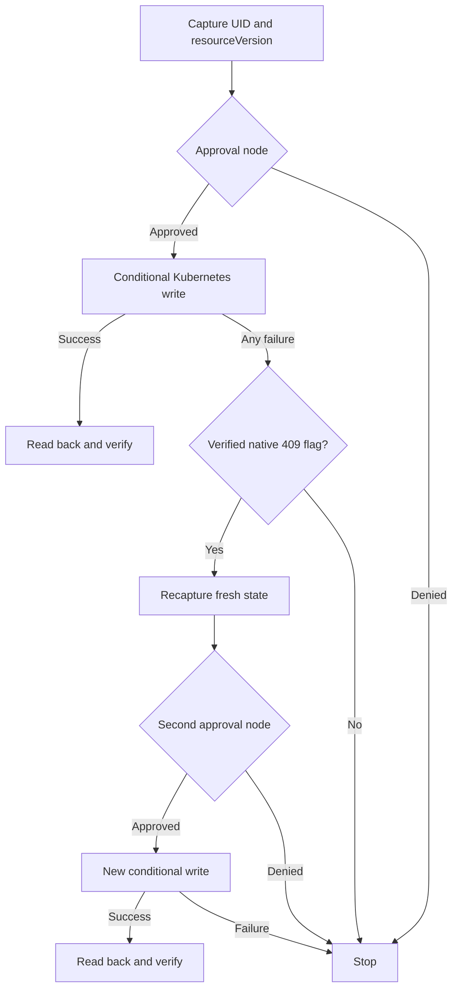

# Approval is not freshness — two-minute reviewer guide

**Red Hat Summit 2027 lightning-talk companion | Earlier public AAP/OpenShift lab series**

**The problem:** Red Hat Ansible Automation Platform (AAP) can pause an automation workflow for approval, but the Red Hat OpenShift Deployment can change during the wait. An approval of a workflow step is not proof that its captured target state is still current.

## Three recorded outcomes

The author reports these manually staged runs from the **earlier native AAP/OpenShift series**. All three are described in the [public run summary](AAP_NATIVE_APPROVAL_EVIDENCE.md#recorded-runs); the underlying AAP job/event exports are **not public**. These are documented observations, **not independently verifiable execution receipts**.

| AAP workflow job | Author-reported outcome | What the control demonstrates |
| --- | --- | --- |
| **93 — no drift** | Conditional write changed desired replicas from 0 to 1; read-back passed | A matching captured `resourceVersion` permits the update |
| **99 — drift, then denial** | Out-of-band scaling to 2; original write rejected as HTTP 409; recapture; second approval denied; no second write | A stale conditional write is rejected, and denial prevents the next action |
| **105 — drift, then reapproval** | Out-of-band scaling to 2; original write rejected as HTTP 409; recapture; second approval granted; new conditional write changed replicas from 2 to 1; read-back passed | A new decision can authorize a new version-conditional write |

The source for these runs is pinned at [`ac14dd54`](https://github.com/praneethhere/aap-evidence-drift-lab/tree/ac14dd54a57c39f8999217a6c982f01d49545c38), and the [published eight-node topology](AAP_NATIVE_WORKFLOW_TOPOLOGY.json) describes the workflow structure, **not the run results**. Approval-node decisions were driven through the AAP API; independent human approval was not demonstrated.

## How it works

*Conceptual decision flow*, not an importable controller graph. The actual workflow has a failure edge from the first action to recapture **for any failure**; the recapture job checks the 409 classification and stops if it is absent. The second action has no recapture-on-failure branch.

**Inspect source:** [capture](../ansible/aap_native/20_capture.yml) · [first action](../ansible/aap_native/21_action_first.yml) · [first verify](../ansible/aap_native/22_verify_first.yml) · [recapture](../ansible/aap_native/23_recapture.yml) · [second action](../ansible/aap_native/24_action_second.yml) · [second verify](../ansible/aap_native/25_verify_second.yml).

## Three takeaways

1. **Approval is not freshness.** Git-managed content and workflow approvals do not freeze the object being changed.
2. **Use Kubernetes' existing optimistic concurrency.** Pass the captured `resourceVersion` to the write; distinguish a confirmed conflict from other failures before attempting recapture and renewed approval.
3. **Know the trust boundary.** A conditional write protects against intervening object changes, but does not prove evidence provenance, approver independence, workload readiness, or durable correctness.

**Limits:** Single lab Deployment, staged timing, author-produced run summaries and self-checks, no public AAP job exports or independently reproduced AAP setup. The separate older restricted-adapter lab did **not** observe a native API-server HTTP 409. The later **W5K R1/R2A/R2B** series and its private receipts are **not** part of these public runs. See the [full limitations and methods](AAP_NATIVE_APPROVAL_EVIDENCE.md#what-this-does-not-show).

[Repository overview](../README.md)
